  
  
  # KĀLARĀJA : THE DARK LORD
  ### Intelligent Brand Sentinel & Company Vibe Verification
  *कालराज • Tamaso Mā Jyotir Gamaya • Ananta Tamas*

  
  
  

---

# BrandShield AI (KĀLARĀJA: Dark Lord Sentinel)

BrandShield AI verifies whether developer-submitted marketing content (posters, banners, ad copy, slogans) matches a company's approved brand vibes and guidelines before publication.

## What It Does

1. **Company Brand & Vibe Setup**:
   - A company creates an account and defines its approved brand identity: personality, mood, visual style, approved HEX color palette, mission statement, and words/claims developers must strictly avoid.
   - The company can upload reference creative work or guidelines to establish its ground-truth standard.
   - The platform extracts and stores a mathematical feature vector (Brand DNA) capturing these standards for $O(1)$ fast retrieval without repeatedly re-reading large files.

2. **Pre-Publication Developer Inspection**:
   - Developers submit their creative assets (image graphics or marketing copy) to inspect compliance against any registered company profile.
   - Accepts either visual image files (PNG, JPG, WEBP) or direct text copy (headlines, body text, slogans).

3. **Multi-Stage Biometric-Style Filtration**:
   - **Color Harmony**: Evaluates dominant colors against approved palettes using CIELAB $\Delta E$ perceptual distance math.
   - **Layout & Negative Space**: Measures whitespace ratios and visual clutter (Laplacian gradient energy) to detect aesthetic departures (e.g., cluttered layouts vs. clean minimalism).
   - **Terminology Scanner**: Deterministically detects prohibited words and claims (e.g., "cheap", "clearance sale", "unlicensed") with context snippet reporting.

4. **Lightweight AI Synthesis**:
   - Compresses the mathematical feature vectors into a concise summary passed to Google Gemini (`gemini-3.5-flash-lite`).
   - Generates fast, explainable feedback on tone, mood, and brand alignment without sending heavy media payloads to the cloud, preserving free-tier quotas and minimizing server resource usage.

5. **Actionable Governance & Fixes**:
   - Produces an explainable inspection report with an overall Vibe Match score (0–100%), biometric breakdown metrics, detected discrepancies, and actionable remediation tips for the developer.
