# BrandShield AI – Intelligent Brand Inspection & Governance Platform

> **Clear brand standards. Evidence-backed reviews. Human approval.**  
> Developed for the **CodeNexus India Hackathon – Inkloom AI Challenge** by **Team Dark Lord** (Suresh Kishor Savant).

---

## 1. System Architecture

BrandShield AI is an inspection and brand-governance platform (not a generative tool). It uses a high-efficiency **Three-Stage Architecture with Brand Profile Confirmation**:

```mermaid
flowchart TD
    subgraph Stage 1: Onboarding & Reference Ingestion
        Q[Company Questionnaire]
        Docs[Brand Guidelines PDF, Approved Posters, Audio Jingles]
    end

    subgraph Stage 2: Brand Intelligence Preparation & Confirmation
        Q --> Pre1[Deterministic Feature Extractor\nPyMuPDF / Pillow / Colorthief]
        Docs --> Pre1
        Pre1 --> AI1[AI Gateway Synthesizer\nGemini 2.5 Flash / OpenAI]
        AI1 --> Draft[Draft Brand Profile]
        Draft --> Conf[Brand Profile Confirmation\nHuman Review & Edit by Company]
        Conf --> DB[(Persistent Database\nbrand_profiles.json / SQLite)]
    end

    subgraph Stage 3: Developer Creative Inspection
        Dev[Developer Creative Submission\nPoster / Copy / Audio] --> Pre2[Fast Preprocessing Pipeline]
        DB --> Delta[Delta Comparison Engine]
        Pre2 --> Delta
        Delta --> DetRule[Deterministic Rule Checks\nCIELAB ΔE Color Distance\nDisallowed Terminology Regex]
        Delta --> LightAI[Lightweight AI Model\nTargeted Delta Vibe & Tone Analysis]
        DetRule --> Report[Explainable Inspection Report]
        LightAI --> Report
        Report --> HumanReview[Human Governance Sign-Off]
    end
```



### Architectural Highlights
- **Zero Re-computation Waste ($O(1)$ Retrieval)**: Guidelines and heavy media references are preprocessed **once** during onboarding. Developer inspections compare content against the compiled, stored profile rather than re-reading 50-page PDFs.
- **Brand Profile Confirmation**: After initial AI synthesis, company executives review, edit, and approve the profile. AI never dictates identity without client sign-off.
- **Strict Separation of Concerns (Rule 11)**: Deterministic code checks (CIELAB color distance, prohibited words) are 100% accurate; AI inferences (mood, tone, aesthetic style) are clearly labeled with confidence metrics.
- **No Mock Hallucinations (Rule 10)**: If external AI API keys are not configured, deterministic checks run at full capacity and AI scores are marked `UNCONFIGURED` (never fabricated).

---

## 2. Technology Stack

| Component | Technology | Rationale & Purpose |
| :--- | :--- | :--- |
| **Backend Framework** | FastAPI (Python 3.15+) | High-throughput, asynchronous REST API with OpenAPI documentation. |
| **Data Validation** | Pydantic v2 & Pydantic-Settings | Strict schema validation and typed configuration management. |
| **PDF Extraction** | PyMuPDF (`pymupdf`) | Lightning-fast text and metadata parsing from PDF brand guidelines. |
| **Image & Color Engine** | Pillow, NumPy, ColorThief, ConvColors | Resolution metrics, Laplacian sharpness variance, and CIELAB $\Delta E$ calculations. |
| **Audio Inspection** | Mutagen | Container, sample rate, bitrate, and duration verification for brand jingles. |
| **Primary AI Multimodal**| Google Gemini API (`google-genai` SDK) | Native vision, audio, text understanding, and structured JSON outputs with low latency. |
| **Alternative AI** | OpenAI API (`openai` SDK, `gpt-4o-mini`) | Lightweight multimodal and JSON reasoning. |
| **Specialized NLP** | Hugging Face Inference API | Serverless sentiment, tone, and embedding inference. |
| **Frontend UI** | Modern Vanilla HTML5, CSS3, ES6+ | Zero-dependency, responsive SPA dashboard with drag-and-drop, color swatches, and review actions. |
| **Testing** | Pytest, Pytest-Asyncio | Automated asynchronous test runner. |

---

## 3. Integrated AI Models & Responsibilities

1. **Google Gemini (`gemini-2.5-flash`)** *(Primary Multimodal)*:
   - High-speed visual composition and aesthetic style inspection.
   - Brand mood, tone, and personality alignment reasoning.
   - Multimodal guideline synthesis.
2. **OpenAI (`gpt-4o-mini`)** *(Alternative Multimodal)*:
   - Base64 visual inspection and structured JSON schema evaluation.
3. **Hugging Face (`distilbert-base-uncased-finetuned-sst-2-english`)** *(Specialized NLP)*:
   - Fast sentiment and emotion polarity classification on marketing copy.
4. **Local Deterministic Engines**:
   - `colorthief` + CIE76/CIE94 CIELAB $\Delta E$ math for objective color distance.
   - Word-boundary regex with context snippets for disallowed terminology.
   - Laplacian kernel variance for image blur detection.

---

## 4. API Key Configuration

Configuration is managed via `.env` in the project root:

```env
# Application Environment
ENVIRONMENT=development
API_V1_PREFIX=/api/v1
DATA_DIR=data
STORAGE_DIR=data/storage

# Primary Multimodal & Reasoning AI (Recommended)
# Obtain from https://aistudio.google.com/
GEMINI_API_KEY=your_gemini_api_key_here

# Alternative Multimodal Reasoning AI
# Obtain from https://platform.openai.com/
OPENAI_API_KEY=your_openai_api_key_here

# Specialized NLP / Sentiment
# Obtain from https://huggingface.co/settings/tokens
HUGGINGFACE_API_KEY=your_huggingface_token_here

# Inspection Defaults
DEFAULT_VISION_MODEL=gemini-2.5-flash
MAX_COLOR_DELTA_E=15.0
MIN_OVERALL_PASS_SCORE=70.0
```

> **Security Note:** `.env` is ignored in `.gitignore`. API keys are never bundled in frontend JavaScript or returned in API responses.

---

## 5. Installation Instructions

### Prerequisites
- Python 3.10+ (Tested on Python 3.15 on Windows 64-bit)
- Git

### Step-by-Step Setup
1. Clone the repository and enter the directory:
   ```bash
   cd "dark lord"
   ```
2. Install Python dependencies:
   ```bash
   pip install -r requirements.txt
   ```
3. Copy the environment configuration:
   ```bash
   cp .env.example .env
   ```
   Edit `.env` to supply your API keys if you wish to run live external AI inference. (If omitted, the deterministic pipeline remains 100% functional).

---

## 6. Execution Instructions

### Start the Application (Backend + Frontend)
Run the server using Uvicorn:
```bash
python -m uvicorn backend.app.main:app --host 127.0.0.1 --port 8000 --reload
```

- **Interactive Web App**: Open [http://127.0.0.1:8000](http://127.0.0.1:8000) in your browser.
- **Swagger Interactive API Documentation**: Open [http://127.0.0.1:8000/docs](http://127.0.0.1:8000/docs).
- **ReDoc Documentation**: Open [http://127.0.0.1:8000/redoc](http://127.0.0.1:8000/redoc).

---

## 7. Testing Instructions

Execute the comprehensive automated test suite (29 tests across all phases):
```bash
python -m pytest tests -v
```

### Test Suite Structure
- `tests/test_config.py`: Central configuration, directory initialization, secret masking.
- `tests/test_ai_gateway.py`: Gateway routing, unconfigured provider detection, Rules 10 & 11 verification.
- `tests/test_preprocessing.py`: Validation, SHA-256 duplicate hashing, CIELAB $\Delta E$, PyMuPDF text parsing, image blur metrics.
- `tests/test_brand_identity.py`: Questionnaire ingestion, guideline synthesis, Brand Profile Confirmation workflow.
- `tests/test_inspection_engine.py`: On-brand posters, off-brand color violations, disallowed terminology, human reviewer approval.
- `tests/test_api_endpoints.py`: End-to-end FastAPI HTTP client integration.
- `tests/test_phase8_validation.py`: The 8 critical operational scenarios (matching, mismatched, tone, audio, corrupt uploads, unconfigured fallback).

---

## 8. Governance & Review Workflow

1. **Company Onboarding**: Brand managers provide guidelines and complete a structured questionnaire.
2. **Profile Confirmation**: The manager reviews AI-synthesized brand characteristics, corrects any discrepancies, and confirms the profile into the database.
3. **Developer Submission**: Creators upload creative assets (posters, copy, audio).
4. **Inspection Engine**: Checks compliance across objective criteria (CIELAB color distance, prohibited terms) and subjective criteria (vibe, mood, tone).
5. **Inspection Report**: Generates an explainable report displaying evidence snippets and actionable remediation advice.
6. **Human Approval**: Authorised reviewers sign off or request modifications with audit notes.

---

## 9. Known Limitations & Future Improvements

- **Local Vision Models**: Currently utilizes cloud multimodal APIs (Gemini/OpenAI) to avoid forcing 15GB model weights onto developer machines. Future releases will support optional local ONNX / llama.cpp vision runtimes.
- **Logo Bounding Box Localization**: Future enhancements will add direct YOLOv8/v11 bounding box overlays for exact spatial logo clearspace checks.
- **CMS Integrations**: Webhook notifications for Figma, Slack, and CMS publishing pipelines (e.g. Contentful / WordPress).

---

## 10. License & Credits

Developed by **Team Dark Lord** (Suresh Kishor Savant, `sureshsavant576@gmail.com`) for the **CodeNexus India Hackathon – Inkloom AI Challenge**, 2026.
