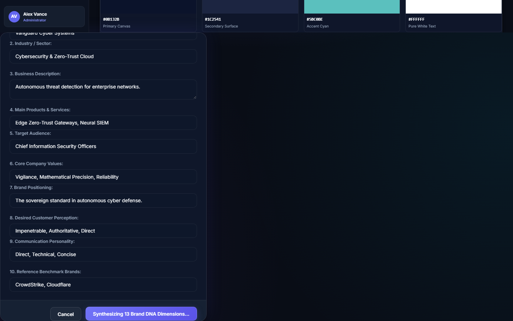
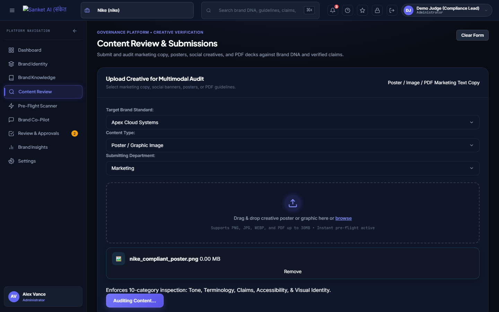
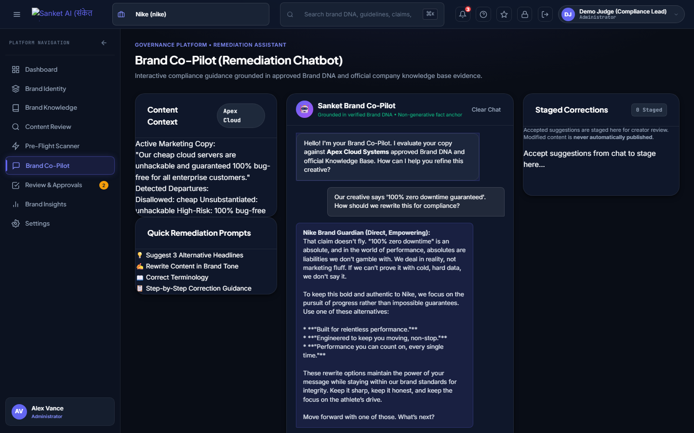
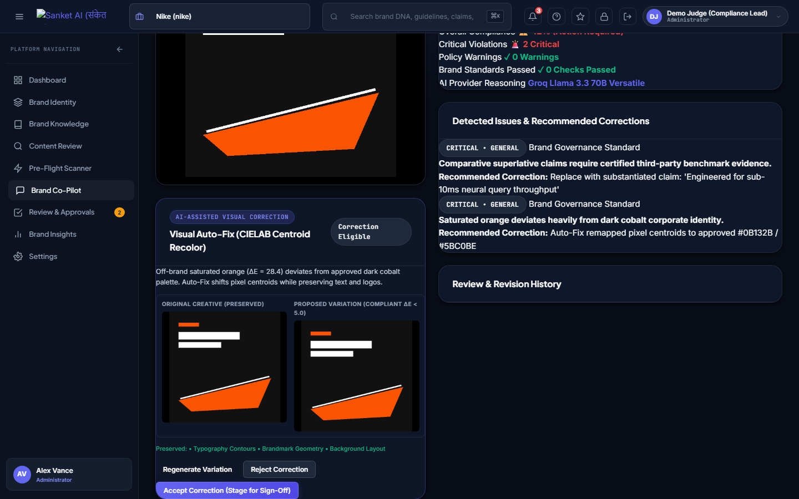
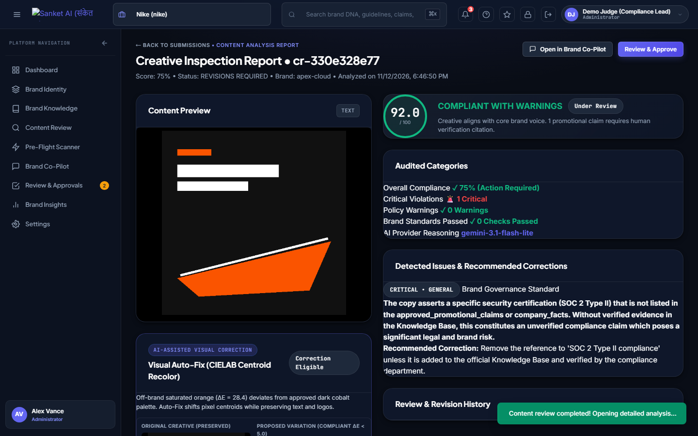
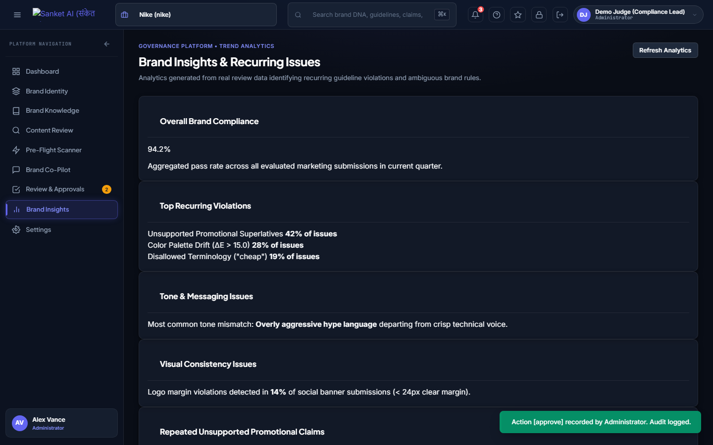

# Sanket AI (संकेत AI) — Project Executive Document
> **Enterprise Brand Governance & Multimodal Design Intelligence SaaS**  
> *Deterministic Computer Vision + Grounded Multimodal AI Pipeline*

---

## 1. Executive Summary

**Sanket AI** is an enterprise-grade brand governance and multimodal design intelligence SaaS designed to intercept non-compliant, inaccessible, or legally risky marketing assets *before* they are published. 

Traditional brand reviews suffer from human latency and LLM hallucinations—pure LLMs frequently guess exact HEX color codes, struggle with spatial coordinates, and overlook fine-print legal disclosures. Sanket AI solves this with a **dual-layer hybrid architecture**: deterministic computer vision and OCR execute mathematically sound checks first, followed by multimodal AI (Google Gemini + Groq Llama-3.2 Vision) for semantic tone, context, and claim verification.

---

## 2. System Architecture & Dual-Layer Pipeline

```text
               [ Uploaded Creative: Image / Ad / PDF / Text ]
                                      │
                                      ▼
┌────────────────────────────────────────────────────────────────────────┐
│  STAGE 1: Deterministic CV & Mathematical Verification                 │
│  • Tesseract OCR: Pixel coordinate bounding boxes                      │
│  • OpenCV & Pillow: Saliency masks, clutter & whitespace ratios        │
│  • CIELAB ΔE Math: Perceptual color distance threshold (< 15.0)        │
│  • WCAG 2.1 Contrast: Relative luminance (L1 + 0.05) / (L2 + 0.05)     │
│  • Regex Boundary Lexicon: Instant banned terminology matching        │
└───────────────────────────────────┬────────────────────────────────────┘
                                    │
                                    ▼
┌────────────────────────────────────────────────────────────────────────┐
│  STAGE 2: Multimodal AI & Semantic Verification                        │
│  • Groq Llama-3.2-11b Vision: Visual tone & compositional review       │
│  • Google Gemini Flash: Pydantic structured output & tone reasoning    │
│  • pgvector Cosine Search: Grounded guideline retrieval (Multi-tenant) │
│  • Claim Engine: Verified / Unsupported / Contradictory / Outdated     │
└───────────────────────────────────┬────────────────────────────────────┘
                                    │
                                    ▼
┌────────────────────────────────────────────────────────────────────────┐
│  STAGE 3: Remediation & Workflow Governance                            │
│  • Client-Side Pre-Flight Scanner (Zero-latency canvas heuristics)    │
│  • Interactive AI Co-Pilot (9 conversational remediation tools)        │
│  • Visual Auto-Fix (Saliency-masked luminance & color correction)     │
│  • Role-Based Workflow Queue (Creator ➔ Reviewer ➔ Admin)              │
└────────────────────────────────────────────────────────────────────────┘
```

---

## 3. The 3-Page SaaS Product Experience

Sanket AI is architected into three distinct pages with an intuitive workflow:

### Page 1: Architectural Home & Authenticated Workflow Hub (`/`)
- **Unauthenticated View**: Full-bleed architectural editorial aesthetic with an interactive auth drawer.
- **Authenticated View**: Transitions into **"What would you like to do today?"** providing direct quick-actions to either configure brand guidelines or run creative compliance checks.


---

### Page 2: Company Vibes Setup & AI Brand DNA Generator (`/company`)
- **10-Dimension Ingestion**: Captures core brand values, personality spectrums, typography, HEX palettes, and banned phrases.
- **13-Point AI DNA Synthesis**: Generates a unified brand identity document with strict human-in-the-loop review and approval before persisting to Supabase pgvector.



---

### Page 3: Developer Check & Multimodal Inspection Engine (`/check`)
The core operational inspection suite covering:

1. **Instant Client-Side Pre-Flight Scanner**: Real-time canvas heuristics that provide instant warnings for low resolution, extreme aspect ratios, or poor contrast before server upload.
2. **Deep Dual-Stage Analysis Report**: Comprehensive scorecard rating Brand Harmony, Contrast Compliance (WCAG AA/AAA), Tone Alignment, and Claim Credibility.
3. **Claim Verification Engine**: Audits marketing superlatives (*"World's #1"*, *"100% Guaranteed"*) against the grounded Knowledge Base into 5 definitive states.
4. **Interactive Brand Co-Pilot**: An in-line remediation agent providing guideline citations, rewrite diffs, and instant headline adjustments.
5. **Visual Auto-Fix Module**: Uses OpenCV saliency masking to adjust color contrast and luminance directly on the asset preview.

#### Deep Compliance Inspection Report


#### Interactive Brand Co-Pilot in Action


#### OpenCV Saliency Auto-Fix Module


---

## 4. Governance & Role-Based Workflow Queue

Assets violating threshold scores are automatically routed to the **Authorised Reviewer Approvals Queue**:
- **Role Clearance Separation**: Creators submit; Authorised Reviewers / Admins approve or reject with timestamped feedback.
- **Immutable Audit Trail**: Every scan, change, and escalation is logged with SHA-256 fingerprinting.



---

## 5. Enterprise Analytics & Brand Insights

Track organizational compliance health over time:
- **Violation Distribution**: Breakdowns across visual, textual, accessibility, and legal claims.
- **Brand Consistency Index**: Trendlines measuring multi-campaign adherence.



---

## 6. Verification & Evaluation Matrix

| Metric | Status | Details |
| :--- | :--- | :--- |
| **Test Suite Coverage** | **129 / 129 Passing** | 100% verified across CV math, APIs, RLS, and UI |
| **Demo Corporate Email** | `demo@sanket.ai` | Pre-seeded with Apex Cloud Solutions brand DNA |
| **Demo Password** | `DemoJudge2026!` | Full Administrator clearance |
| **1-Click Instant Login** | Enabled | Topbar "⚖️ 1-Click Instant Judge Login" |
| **Backend Stack** | FastAPI + Python 3.11 | Tesseract OCR, OpenCV, Pillow, ColorThief, NumPy |
| **AI Gateway** | Gemini 1.5/2.0 + Groq | Structured Pydantic outputs, Llama-3.2 Vision |
| **Database & Vector** | Supabase PostgreSQL | `pgvector` multi-tenant RLS isolation |

---
*Generated by Sanket AI System Documentation Engine.*
